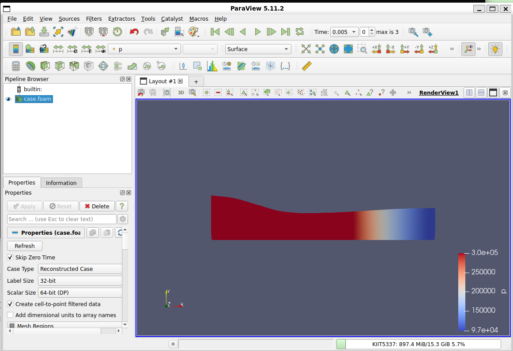
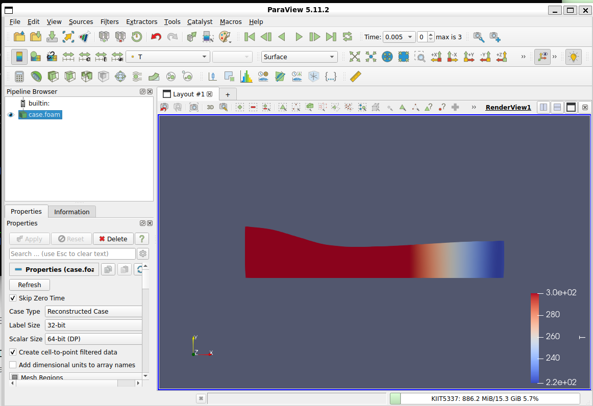
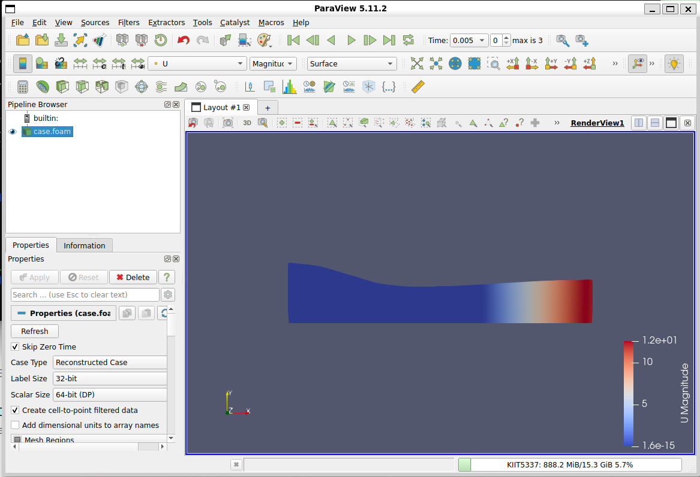
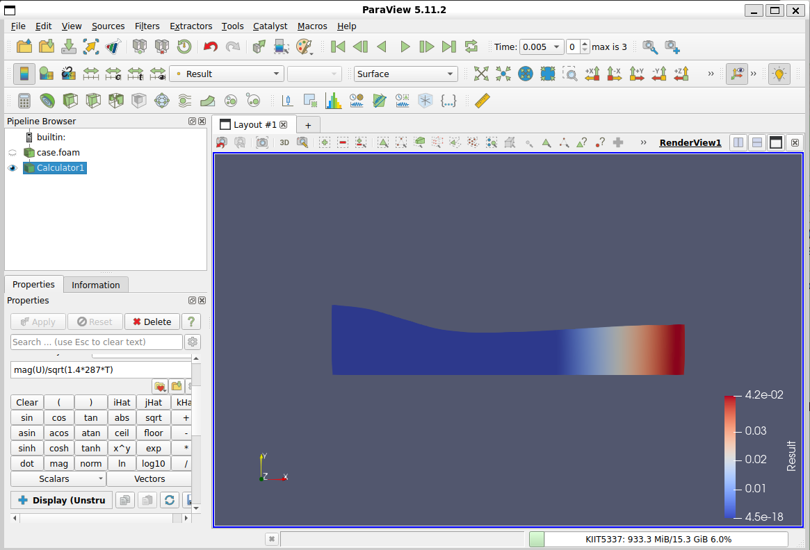

# Convergent-Divergent-Nozzle-Flow-in-OpenFOAM-14
A compressible, inviscid flow simulation through an axisymmetric convergent-divergent (de Laval) nozzle, run in OpenFOAM 14 and post-processed in ParaView. I built this while working through the IIT Bombay Spoken Tutorial on nozzle flow, but I ended up changing quite a bit of it, because the tutorial is written for older OpenFOAM versions and some of its setup doesn't carry over to v14.

## What this project does

A high-pressure reservoir pushes air through a nozzle that narrows to a throat and then widens again. If the pressure ratio is large enough, the flow chokes at the throat and goes supersonic in the diverging part. I wanted to see that happen in a proper density-based solver, with pressure, temperature, velocity and Mach number fields to look at afterwards.

The geometry is 2D axisymmetric, so I modelled it as a thin 5° wedge instead of a full 3D nozzle. That keeps the mesh at 3,000 cells and the run short.

## Why not rhoCentralFoam?

The tutorial uses `rhoCentralFoam`. The binary still exists in OpenFOAM 14, but the newer way to run the same central-upwind scheme is `foamRun` with the `shockFluid` solver module, and the dictionary layout (`physicalProperties`, `momentumTransport`, etc.) follows that. I copied `constant/` and `system/` from the `shockFluid/obliqueShock` tutorial that ships with OpenFOAM 14 so the syntax would match, then changed what I needed.

I also skipped the `codeStream` trick the tutorial uses to generate the spline points inside `blockMeshDict`. Instead I calculated the points outside OpenFOAM and wrote them straight into the file. Same curve, one less thing to compile and break.

## Setup

**Geometry** (total length 0.25 m)

| Location | x (m) | Radius (m) |
|---|---|---|
| Inlet | 0 | 0.05 |
| Throat | 0.10 | 0.03 |
| Outlet | 0.25 | 0.036 |

The converging section follows a cosine curve from the inlet radius down to the throat, and the diverging section opens out smoothly to the exit radius. Both walls are defined with `spline` edges in `blockMeshDict`.

**Mesh:** two blocks, 60 x 20 cells in the converging part and 90 x 20 in the diverging part, with 1 cell across the wedge. `checkMesh` reports `Mesh OK`.

**Wedge angle:** 5° total (2.5° each side). One thing that bit me: if you round the vertex coordinates too much, the wedge faces stop being exactly planar and `checkMesh` fails. Computing the coordinates with full precision fixed it.

**Boundary conditions**

| Patch | p | T | U |
|---|---|---|---|
| inlet | fixedValue 300000 Pa | fixedValue 300 K | zeroGradient |
| outlet | fixedValue 100000 Pa | zeroGradient | zeroGradient |
| wall | zeroGradient | zeroGradient | slip |
| front / back | wedge | wedge | wedge |

The domain starts at 300 kPa, 300 K and zero velocity everywhere.

**Physics:** inviscid (`mu = 0`, `Pr = 1` in `physicalProperties`). The thermophysical model comes from the `obliqueShock` template.

**Time control:** end time 0.02 s, write every 0.005 s, initial time step 1e-7 s, adjustable time step with max Courant number 0.2. The run took about 88 seconds on my laptop.

## How to run it

Make sure OpenFOAM 14 is sourced first:

```bash
source /opt/openfoam14/etc/bashrc
```

Then, from inside the case folder:

```bash
blockMesh > log.blockMesh 2>&1
checkMesh
foamRun > log.run 2>&1
touch case.foam
```

Open `case.foam` in ParaView (`paraview case.foam`), tick `p`, `T` and `U`, hit Apply, and jump to the last time step.

For Mach number I used the Calculator filter with:

```
mag(U)/sqrt(1.4*287*T)
```

That assumes air with gamma = 1.4 and R = 287 J/(kg K). If you change the thermo model, change these numbers too.

## Results

| Pressure | Temperature |
|---|---|
|  |  |

| Velocity | Mach number |
|---|---|
|  |  |

## Things to keep in mind

- The run only goes to 0.02 s. That's enough to see the flow develop through the nozzle, but I wouldn't call it fully steady. If you need a converged solution, raise `endTime` and run it longer.
- The mesh is fairly coarse. Shock features will look smeared compared to a refined grid.
- I haven't validated the Mach numbers against isentropic area-Mach relations yet. That's the obvious next step, along with a mesh refinement check.
- The flow is inviscid, so there are no boundary layers and no wall friction effects.

## Repository structure

```
.
├── 0/                      initial fields (p, T, U)
├── 0.005/                  results at t = 0.005 s
├── 0.01/                   results at t = 0.01 s
├── 0.015/                  results at t = 0.015 s
├── 0.02/                   results at t = 0.02 s
├── constant/               physicalProperties and related settings
├── system/                 blockMeshDict, controlDict, fvSchemes, fvSolution
├── case.foam               empty file so ParaView can open the case
├── log.blockMesh           mesh generation log
├── log.run                 solver log
├── mach_number_contour.png
├── p_contour.png
├── T_contour.png
└── U_contour.png
```

## Tools

- OpenFOAM 14 (Foundation) on Ubuntu
- ParaView
- Python, only to calculate the spline coordinates for the nozzle walls

## Author

**Pratyush Dash**
